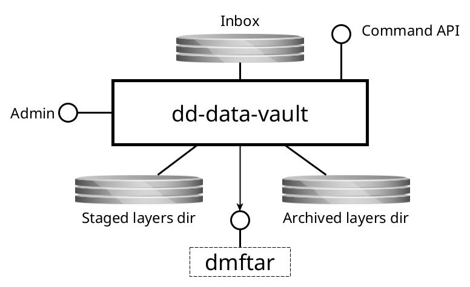

dd-data-vault
=============

Manages a DANS Data Vault Storage Root

Purpose
-------
A DANS Data Vault Storage Root is an OCFL storage root used to store a collection of long-term preservation objects.

Interfaces
----------
This service has the following interfaces:

{width="70%"}

### Provided interfaces

#### Inbox

* _Protocol type_: Shared filesystem
* _Internal or external_: **internal**
* _Purpose_: to receive [Object Import Directories](#object-import-directories)

#### Command API

* _Protocol type_: HTTP
* _Internal or external_: **internal**
* _Purpose_: to manage the service including starting imports

#### Admin console

* _Protocol type_: HTTP
* _Internal or external_: **internal**
* _Purpose_: application monitoring and management

### Consumed interfaces

#### DMFTAR (optional)

* _Protocol type_: Local command invocation
* _Internal or external_: **external**
* _Purpose_: to create DMFTAR archives in the [SURF Data Archive]{:target=_blank}. The `localTransferRoot` setting of the archive provider specifies the
  local directory in which dmftar directories are created before being transferred (with `rsync`, configurable) to the archive, and into which they are fetched
  before being unpacked. When a layer is archived, its dmftar directory is first created locally, then rsynced to a `<name>.partial` directory in the
  remote archive root, verified there, and only then moved into place; afterwards the local copy is removed. Interrupted transfers are retried and resumed. When a layer is reopened, the dmftar directory is rsynced into `localTransferRoot` (resuming any partial download), optionally verified locally (`verifyDownloadedCopy`), extracted into the staging area and then removed locally; at most `maxParallelUnarchive` layers are unarchived at the same time. The `rsync`, `ssh` (verify), retry and moratorium settings are documented in the configuration file. This interface is optional because
  it is only used if the DMFTAR archive provider has been configured. (The other archive providers use Java code to create the archives and do not require an
  external interface.)

[SURF Data Archive]: {{ surf_data_archive }}

### Object Import Directories

Objects versions to be imported must be placed under the inbox in a batch directory. The layout of the batch directory is as follows:

```plaintext
batch-dir
 ├── urn:nbn:nl:ui:13-26febff0-4fd4-4ee7-8a96-b0703b96f812
 │   ├── v1
 │   │   └── <content files>
 │   ├── v1.json
 │   ├── v2
 │   │   └── <content files>
 │   ├── v2.json
 │   ├── v3
 │   │   └── <content files>
 │   └── v3.json
 ├── urn:nbn:nl:ui:13-2ced2354-3a9d-44b1-a594-107b3af99789
 │   ├── v3
 │   │   └── <content files>
 │   └── v3.json
 └── urn:nbn:nl:ui:13-b7c0742f-a9b2-4c11-bffe-615dbe24c8a0
      ├── v1
      │   └── <content files>
      └── v1.json
```

* `batch-dir` - The batch directory is the directory where the batch of objects to be imported is placed.
* `urn:nbn:nl:ui:13-26febff0-4fd4-4ee7-8a96-b0703b96f812` - The directory name is the identifier of the object in the OCFL Storage Root. The pattern that an
  identifier must match can be [configured]{:target=_blank}.
* `v1`, `v2`, `v3` - The version directories contain the content of the object versions. The version directories must be named `v1`, `v2`, `v3`, etc.
  The first version directory must be named after the next version to be created in the OCFL object.
* A version directory must be accompanied by a version info JSON file named `vN.json`, where `N` is the version number (e.g., `v2.json` for
  version 2). This version info JSON file is required for every version. It must have a structure as in the example below.

[configured]: {{ config_file_url }}

##### Example version info JSON file

```json      
{
  "version-info": {
    "user": {
      "name": "John Doe",
      "email": "john.doe@mail.com"
    },
    "message": "Commit message"
  },
  "object-version-properties": {
    "dataset-version": "1.2",
    "packaging-format": "DANS RDA BagPack/1.0.0"
  }
}
```

Requirements and notes:

- The `version-info` object is mandatory and must include `user.name`, `user.email`, and `message`.
- `version-info.user.email` may be specified with or without the `mailto:` prefix; the service will normalize it to `mailto:`.
- The `object-version-properties` object is optional and may contain any custom properties to be stored for the object version. These are written to the
  [Object Version Properties]{:target=_blank} extension.

[Object Version Properties]: {{ object_version_properties_ext }}

Processing
----------

### Order of batches

To ensure that updates for one object are processed in the correct order, the service will process all batches in the inbox in the order they were received.
Otherwise, it would be possible that a later batch would overtake an earlier batch. If these two batches contain updates for the same object, this would lead to
an error because the version directory would not coincide with the next expected version in the OCFL object.

### Parallelization of object import directory processing

Per batch the object import directory processing can be parallelized because there can be only one object import directory per object in a batch. The task that
processes the object import directory ensures that the version directories are processed in the correct order.

### Automatic layer creation

After processing a batch, the service will check if the maximum size of the layer has been reached. If this is the case, the service will create a new layer
and start the archiving process of the old layer. Since object import directories are processed in parallel, it is not possible to do a more fine-grained
check for the maximum size of the layer.

### Layer archive jobs

Every request to archive a layer (automatic or via the API) is recorded as a job in the `layer_archive_job` table, with status `PENDING`, `RUNNING`, `SUCCESS` or
`FAILED`. The service polls for pending jobs (`layerStore.layerArchiver.pollingInterval`) and runs at most `layerStore.layerArchiver.maxParallelArchiveJobs` of them
in parallel. A job first runs the consistency check of the layer and then archives it. If the service is restarted, unfinished jobs are resumed. While a
[moratorium](#dmftar-optional) on network actions towards the remote archive is in effect, no jobs are started, and a job that runs into the moratorium goes back to
`PENDING`. A job that fails stays `FAILED`; the layer remains in the staging area and can be archived again via the API.
